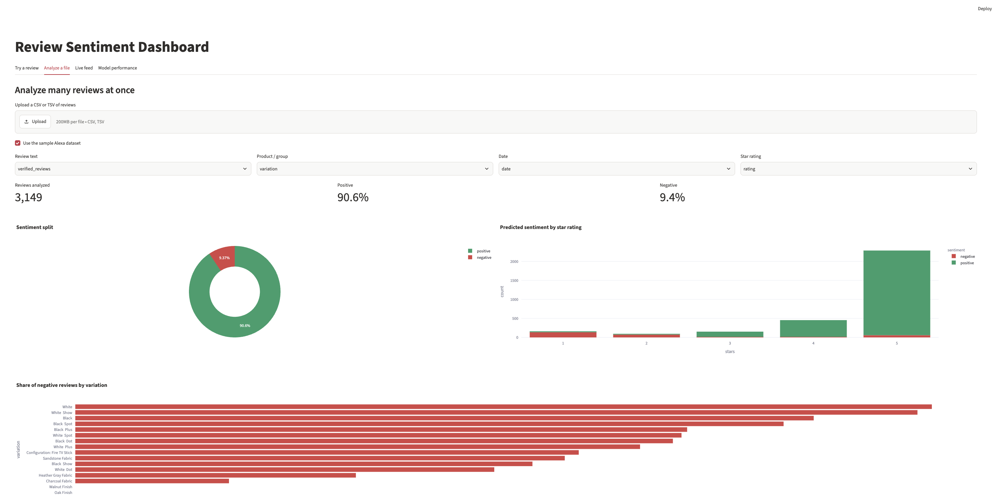
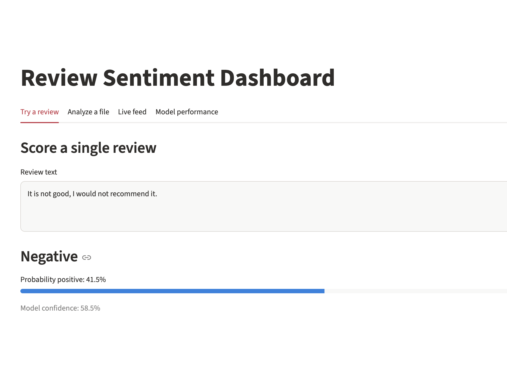
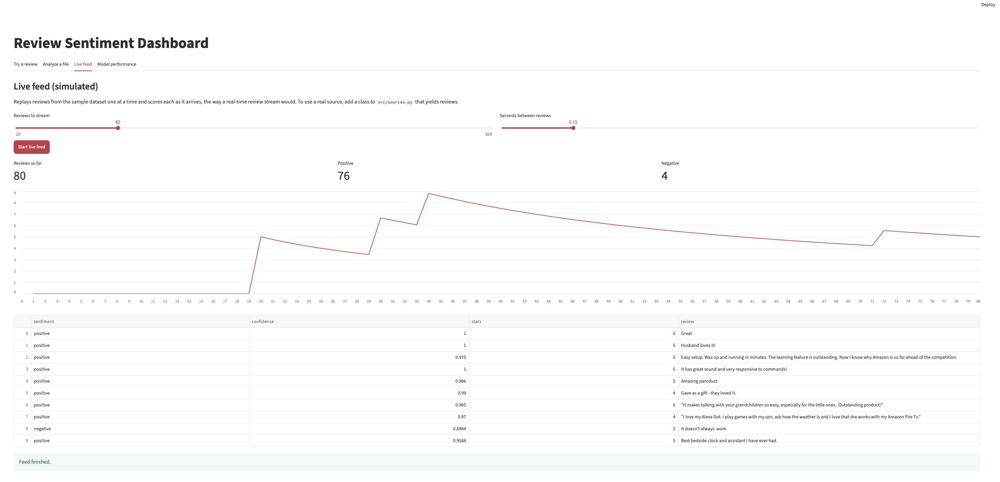
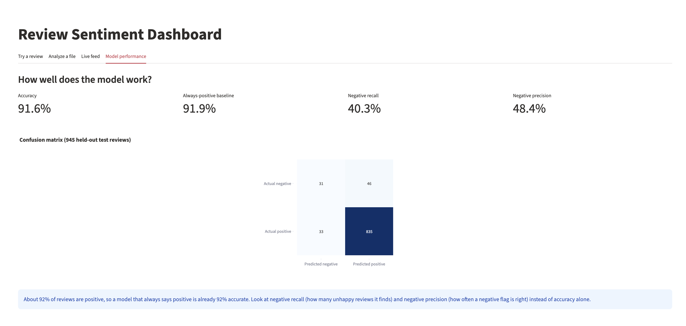
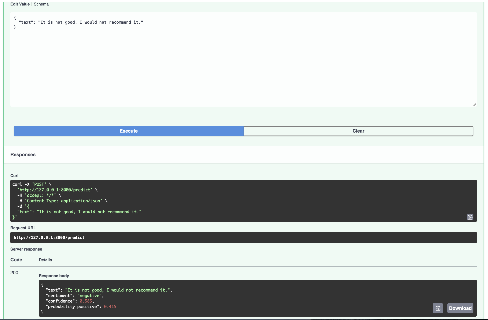
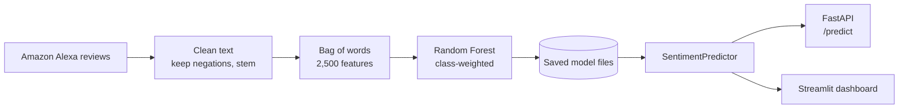

# Amazon Alexa Review Sentiment: End-to-End ML Project


[](https://colab.research.google.com/drive/19RU6pSilm5sFOhFYH5nBzAkNtCB1CeIR)

A machine learning project that takes customer reviews of Amazon Alexa devices from a notebook experiment to a **deployed product**: a trained model, a **REST API (FastAPI)** and an **interactive dashboard (Streamlit)** with a live review feed.

### 🔗 Live demo: 🔗  [alexa-sentiment.streamlit.app](https://alexa-sentiment.streamlit.app)



## What it does

- Classifies a review as **positive** or **negative**, with a confidence score.
- Lets anyone explore a whole file of reviews through charts, search and CSV export.
- Replays reviews as a **live feed**, scoring each one as it arrives.
- Shows the model's **honest performance**, including its weak spots.
- Exposes the same model through a **REST API** for other programs to use.

## Screenshots

### Score a single review

Type or paste a review and see the sentiment, the probability of positive and the model's confidence.



### Analyze a file of reviews

Upload a CSV or TSV (or use the built-in sample) to get the sentiment split, sentiment by star rating, the share of negative reviews by product, a trend over time, the most common words in positive and negative reviews, a searchable table and a CSV download.


### Live feed

Reviews arrive one at a time and are scored in real time, with running counts, a live chart of the percentage of negative reviews and a table of the latest reviews.



### Model performance

Accuracy, precision and recall for the negative class, a confusion matrix and the always-positive baseline, so the model is judged honestly.



### REST API

Automatic interactive documentation for single and batch predictions.



## How it works



1. **Clean:** lowercase, remove punctuation and stopwords, and stem each word. Negation words such as *not* are kept.
2. **Features:** a bag of words with the 2,500 most frequent words, scaled to a 0 to 1 range.
3. **Model:** a Random Forest (200 trees) with class weights, trained on a stratified 70/30 split.
4. **Serve:** one `SentimentPredictor` class loads the saved model and is used by both the API and the dashboard, so they always give identical answers.

### Example prediction

| Review | Prediction | Confidence |
|---|---|---|
| It is not good, I would not recommend it. | negative | 0.585 |

A confidence this close to 0.5 shows how uncertain the model is on negative reviews. See the results below.

## Results

Evaluated on a held-out test set of 945 reviews (77 negative, 868 positive):

| Metric | Value |
|---|---|
| Accuracy | 91.6% |
| Always-predict-positive baseline | 91.9% |
| Negative recall (unhappy reviews found) | 40.3% (31 of 77) |
| Negative precision (negative flags that are right) | 48.4% |
| Negative F1 | 0.44 |

Confusion matrix (rows = actual, columns = predicted):

| | Predicted negative | Predicted positive |
|---|---|---|
| **Actual negative** | 31 | 46 |
| **Actual positive** | 33 | 835 |

**How to read this honestly:** about 92% of the reviews are positive, so a model that always says "positive" already scores 91.9%. The model's accuracy does not beat that baseline, so accuracy is the wrong measure here. The useful question is how many negative reviews it finds. It finds about 4 in 10, and about half of its negative flags are false alarms. This is the weak spot of the project, and the next improvement should target it.

## Key findings and design decisions

| Decision or finding | Why it matters |
|---|---|
| **Judge the model on negative-class recall and F1, not accuracy** | A model that never reads a word scores 91.9% accuracy. |
| **Tested class weights (`class_weight='balanced'`)** | A plain Random Forest reached 94.4% accuracy and found only 34% of negative reviews, with 93% precision (negative F1 0.50). Class weights raised recall to about 40% but cut precision to about 48%, and the negative F1 fell to 0.44. The class weights helped only a little, and that finding is why threshold tuning is the next step. |
| **Keep negation words** | Standard stopword lists delete *not*, which flips a review's meaning. *not* is the most frequent word in negative reviews. |
| **Stratified train/test split** | The negative class is only 8% of the data, so the split must keep that mix in both parts. |
| **Fit the scaler on training data only** | Fitting it on all data would leak information from the test set into training. |
| **One shared predictor class** | Training, API and dashboard use the same cleaning and model code, so their results cannot drift apart. |

**A property of the data worth knowing:** the `feedback` label turns out to be a simple rule on the star rating (1 to 2 stars = negative, 3 to 5 stars = positive). Nobody judged the text, so the model is effectively learning to guess a star rating from the words. Lukewarm 3-star reviews count as positive, which makes the negative class harder to separate.

## Tech stack

Python 3.12 · pandas · NumPy · scikit-learn · NLTK · FastAPI · Uvicorn · Streamlit · Plotly · Git and GitHub · Streamlit Community Cloud

## Quick start

Requires Python 3.12.

```bash
git clone https://github.com/sonujose123/End-to-End-Sentiment-Analysis-ML-Project.git
cd End-to-End-Sentiment-Analysis-ML-Project

python3.12 -m venv .venv
source .venv/bin/activate
pip install -r requirements.txt
```

The trained model files are included in `models/`. The first run downloads NLTK's stopword list automatically.

### Run the dashboard

```bash
streamlit run dashboard/app.py
```

### Run the API

```bash
uvicorn api.main:app --reload
```

Open http://127.0.0.1:8000/docs for the interactive documentation, or call it directly:

```bash
curl -X POST http://127.0.0.1:8000/predict \
  -H "Content-Type: application/json" \
  -d '{"text": "Love my Echo, the sound is great!"}'
```

```json
{
  "text": "Love my Echo, the sound is great!",
  "sentiment": "positive",
  "confidence": 1.0,
  "probability_positive": 1.0
}
```

| Endpoint | Description |
|---|---|
| `GET /health` | Check that the service is running |
| `POST /predict` | Score one review (`{"text": "..."}`) |
| `POST /predict/batch` | Score up to 500 reviews (`{"texts": [...]}`) |

Requests with empty text, or text longer than 5,000 characters, are rejected with a 422 error.

### Re-run the evaluation

```bash
python -m src.evaluate
```

This measures the saved model on the held-out test set and writes `models/metrics.json`, which the dashboard's Model performance tab reads.

## Project structure

```
.
├── api/
│   └── main.py              # FastAPI service
├── dashboard/
│   ├── app.py               # Streamlit entry point
│   ├── common.py            # Shared loaders and colors
│   └── tab_*.py             # One file per dashboard tab
├── src/
│   ├── config.py            # Paths and settings
│   ├── preprocess.py        # Text cleaning
│   ├── predict.py           # SentimentPredictor class
│   ├── evaluate.py          # Test-set evaluation
│   ├── analysis.py          # Helpers for dashboard charts
│   └── sources.py           # Review sources for the live feed
├── models/                  # Saved vectorizer, scaler, model and metrics
├── data/amazon_alexa.tsv    # Dataset
├── notebooks/               # Exploration and model training (Colab)
├── docs/screenshots/        # Images used in this README
├── requirements.txt
└── README.md
```

## Dataset

Amazon Alexa product reviews: 3,150 verified reviews with a star rating, date, product variation and review text. About 92% are positive and 8% are negative. Source: Dataset is available in the data folder.

## What this project demonstrates

- **End-to-end ownership:** data exploration, preprocessing, modelling, evaluation, an API, a dashboard and a public deployment.
- **Honest evaluation:** a baseline comparison, class-imbalance handling, and metrics chosen to match the real goal.
- **Clean engineering:** modular code, one shared predictor, pinned dependencies and input validation.
- **Product thinking:** a live feed, file upload, search and export, designed around how someone would actually use the model.

## Limitations and next steps

- **Negative reviews are the weak spot** (recall 40%, F1 0.44). Next experiments: tune the decision threshold (the model currently predicts negative only when the probability of positive is below 50%), use TF-IDF with word pairs (so the model can see "not good"), tune hyperparameters, or fine-tune a transformer model.
- **A bag of words ignores word order**, so sarcasm and subtle phrasing are hard for it.
- **Trained on Alexa reviews only.** It may not transfer well to other products or to other languages.
- **The "Analyze a file" sample uses reviews the model was trained on**, so those numbers are optimistic. The held-out results above are the honest ones.
- **The live feed is simulated** by replaying the sample dataset. `src/sources.py` is designed so a real review source can be plugged in. Amazon and Flipkart restrict scraping in their terms of service, so use official APIs or datasets you have permission to use.
- **The vectorizer was fitted on all reviews before the split.** No labels were involved, so the effect is small, but a scikit-learn `Pipeline` would remove it.
- The free hosting tier puts idle apps to sleep, so the first visit after a pause can take about 30 seconds.

## Author

**Sonu Jose** · [GitHub](https://github.com/sonujose123)
